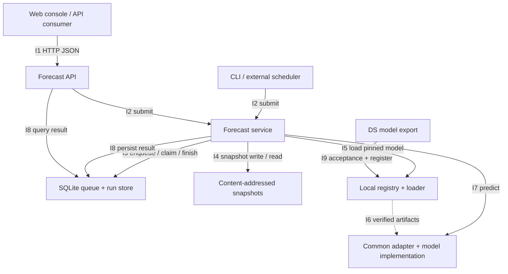

# Architecture

The application owns execution and provenance. Models own model-specific preprocessing, prediction and inverse transforms. Python modules are responsibility boundaries, not mandatory microservices.

## Interfaces

| ID | Contract | Current implementation |
| --- | --- | --- |
| I1 | `ForecastRequest` -> `RunView` | FastAPI POST/GET |
| I2 | `ForecastService.submit()` | Shared by HTTP and CLI |
| I3 | `submit`, `claim`, `finish` | SQLite transactions + ownership token |
| I4 | `ForecastInput` -> snapshot ID -> `ForecastInput` | SHA-256 input snapshots in SQLite |
| I5 | `load(model_id, version)` -> `LoadedModel` | Explicit immutable version, no moving `latest` |
| I6 | Manifest + SHA-256 artifact files | Filesystem registry; explicit adapter allowlist |
| I7 | `predict(ForecastInput)` -> `ModelPrediction` | Model-independent pre/post validation |
| I8 | `ForecastResult` | Same transaction as successful run completion |
| I9 | Package + golden input/output | CLI acceptance, then atomic registration |

`ForecastService.work_once()` runs in a separate worker process. The API does not run inference in an in-process background task. Restarting the API does not lose queued work. SQLite is a local reference backend; queue and registry implementations can be replaced as scale and deployment requirements become known.

## Execution

1. Validate request structure and model applicability.
2. Resolve the exact package digest and persist the request plus immutable input snapshot.
3. A worker claims one job transactionally.
4. Read the snapshot, verify its digest, and reload the pinned model package.
5. Validate required inputs, run inference, and validate the output timeline and meaning.
6. Atomically persist the result and successful status, or a stable failure code.

Each result carries a run ID, series identity, as-of time, model version, package digest, snapshot ID and generation time. The `as_of` cutoff is caller supplied, not wall-clock execution time, allowing historical replay.

## Model lifecycle

Registration copies only declared artifacts into a staged directory. It verifies checksums, loads the installed adapter, runs its golden example, reloads it, and checks reproducibility. A successful package is atomically promoted to a versioned directory. Existing versions cannot be overwritten by the registry API.

Package checks are technical acceptance, not statistical backtesting. Accuracy thresholds, tail-price behavior and downstream trading utility require a separate evaluation pipeline and business criteria.

## Planned boundaries

Live ingestion, feature stores, training/backtesting runners, managed scheduling, remote registries, distributed queues and identity providers are extension points, not simulated production integrations. No agent harness is required in the online forecast execution path.
